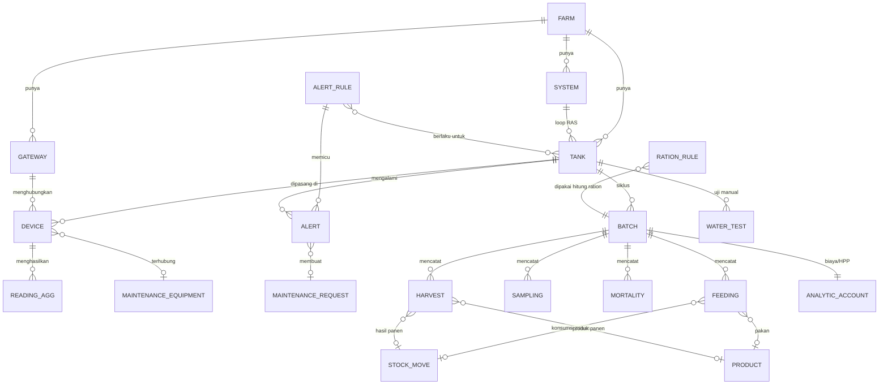

# ERD - Modul aqua_ras

## Alur data singkat
Sensor -> MQTT -> Node-RED (agregat 1 menit, antrian offline) -> `POST /aqua/ingest` -> `aqua.reading.agg`
-> evaluasi `aqua.alert.rule` -> `aqua.alert` (+ chatter, Telegram, maintenance request, eskalasi).
